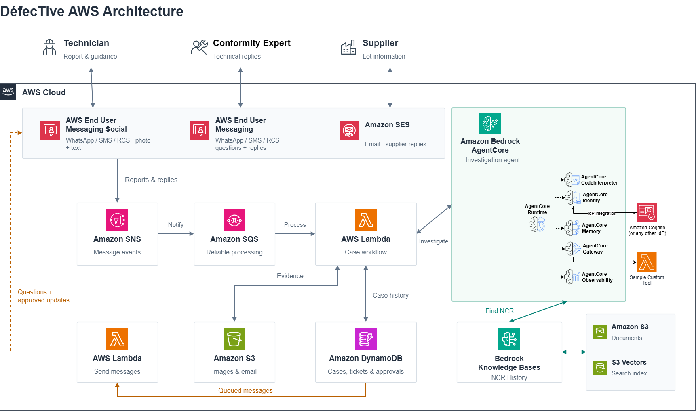

# DéfecTive — Multichannel Conformity Assistant on Amazon Bedrock AgentCore

> Built for the **AWS CDS Partner Hackathon** ([devpost](https://aws-cds-partner.devpost.com/)).
> A multichannel conformity assistant for an operations team, built with **Strands-Agents** and Amazon Bedrock on top of AWS End User Messaging.

A field technician reports an equipment non-conformity (leak, crack, corrosion, wrong reading, damage)
— **optionally with a photo** — over **WhatsApp or SMS**. A Strands agent searches past Non-Conformity
Reports in an Amazon Bedrock Knowledge Base, drafts a handling procedure and opens a case. A **conformity
expert** approves or rejects it from their own 1:1 chat; the approval automatically e-mails the validated
procedure to the equipment contractor. Replies return on the channel the message arrived on, and the
conversation is shared across channels (AgentCore Memory, keyed by person).

## Architecture



AWS End User Messaging (WhatsApp/SMS) → SNS (customer-managed KMS key) → **channel-handler Lambda**
(normalizes the envelope, resolves the sender to a Cognito identity/role, invokes the AgentCore Runtime
with `X-Amzn-Bedrock-AgentCore-Runtime-User-Id`, dispatches the reply, writes both directions to the
transcript table) → **Strands agent on AgentCore Runtime** (Nova Pro, AgentCore Memory, Gateway MCP
client) → **AgentCore Gateway** (JWT authorizer + Cedar policy engine: `record_validation` is
expert-only) → tool Lambdas (`search_ncr_history` → Bedrock KB, `create_case`/`get_case`/`list_cases`/
`record_validation`, `send_contractor_email`/`request_expert_validation`). The frontend is the React chat (Amplify-deployed).

Editable architecture diagram: [`docs/architecture-diagram/DefecTive_Architecture.drawio`](docs/architecture-diagram/DefecTive_Architecture.drawio) (open with [draw.io](https://app.diagrams.net/)).

## Prerequisites

- AWS account in `eu-west-1`, with Bedrock model access to `eu.amazon.nova-pro-v1:0`.
- A Bedrock Knowledge Base holding past NCRs — `scripts/ingest-ncr-text.py` loads the 92 synthetic
  text NCRs from `data/`; point `conformity.knowledge_base_id` in `infra-cdk/config.yaml` at your KB.
- Node.js 20+, Python 3.11+, `uv` (or `pip`), Docker (only if you deploy locally instead of CodeBuild).
- A Cognito user pool is created by the stack; no manual setup.
- Optional: an AWS End User Messaging Social (WhatsApp) integration and/or an SMS origination for real
  channels. The demo runs without any of this (see "What is mocked" below).

## Deploy (in-cloud via CodeBuild — recommended)

AgentCore Runtime is ARM64-only; building locally on Windows is painful. The script zips git-tracked
files, builds in CodeBuild, streams logs, and tears down build resources on success:

```bash
python scripts/deploy-with-codebuild.py
```

It does **not** seed contacts. After it succeeds:

```bash
uv run scripts/seed-contacts.py                 # create a Cognito user per expert + seed contacts table
uv run scripts/ingest-ncr-text.py               # publish the 92 synthetic NCRs to the KB (idempotent)
uv run scripts/provision-sms.py --simulator     # EUM simulator origination + demo numbers
uv run scripts/smoke-channels.py                # which channels are live, and why
```

Direct deploy also works if you have Docker locally: `cd infra-cdk && cdk deploy`.

Validate the CDK without Docker: `cd infra-cdk && npx tsc --noEmit`.

## Post-deploy: make a channel real (optional)

- **SMS (real handset, French):** `docs/SMS_FR_SETUP.md` — sandbox OTP, sender-ID quirks, verified
  destinations, production-access request.
- **WhatsApp:** link a WABA → `PutWhatsAppBusinessAccountEventDestinations` → `conformity-agent-inbound`,
  then remove `whatsapp` from `conformity.mock_channels`.
- **Email:** verify an SES identity, set `conformity.mock_email: false`, set `contractor_email_from`.

## Demo

**Video:** [Watch on YouTube](https://www.youtube.com/watch?v=aWs6lpiPDRU) *(unlisted)*

Run the two-phone emulator locally:

```bash
uv run scripts/phone-emulator.py --technician 14254147855 --expert 5511999998888 --image demo/sample.png
# open http://localhost:8787
```

Click-by-click walkthrough with the real-vs-simulated table: **`docs/DEMO_SCRIPT.md`**.

End-to-end via CLI (publishes a realistic inbound envelope to the stack's SNS topic and tails the reply):

```bash
uv run test-scripts/test-channel.py "Here is a photo of a damaged cable. Equipment is Cable C-102, urgency medium, contractor is CableWorks dr.boris.quintana@gmail.com. Draft a procedure." --channel sms --phone 14254147920
uv run test-scripts/test-channel.py "approve NC-YYYYMMDD-xxxxxx" --channel sms --phone 5511999998888   # expert approves -> e-mail auto-sent
uv run test-scripts/test-channel.py "status" --channel sms --phone 14254147920                          # -> CONTRACTOR_NOTIFIED
```

## What is mocked (and why)

| Flag | Default | Effect |
|---|---|---|
| `conformity.mock_channels` | `whatsapp,email,rcs` (sms **live**) | Listed channels log the reply instead of sending. Remove a channel to send for real. |
| `conformity.mock_email` | `false` (**live SES**) | `send_contractor_email` sends via SES from `contractor_email_from` — verify a sender identity and the recipient first (SES sandbox). |
| RCS | always stubbed | `_send_rcs` logs "rcs-not-provisioned" (no RCS agent registered). |
| Expert push notification | mocked | `request_expert_validation` logs the ping; mirrored into the transcript table so the phone emulator lights up. |

Out of the box: **SMS is live** (to EUM simulator destinations — run `scripts/provision-sms.py --simulator`),
**e-mail is live** via SES once identities are verified, and **WhatsApp/RCS are mocked**. The phone
emulator works with no phone number, WABA, or SES setup at all.

## Project layout

```
infra-cdk/                       # all infrastructure (TypeScript CDK), driven by config.yaml
  config.yaml                    # single source of truth for conformity settings
  lambdas/channel-handler/       # SNS -> normalize -> resolve user -> InvokeAgentRuntime -> dispatch
  lambdas/pretoken-v3/           # injects role claim from the contacts table
gateway/tools/{ncr,case,mail}_tool/   # one Lambda per tool group + tool_spec.json
gateway/interceptor/             # copies JWT user_id/role into tool args
gateway/policies/policy.cedar   # record_validation is expert-only
patterns/conformity-agent/       # the agent (basic_agent.py, locales, tools/session.py)
scripts/                        # deploy, seed-contacts, provision-sms, smoke-channels, ingest-ncr-text, phone-emulator
test-scripts/                   # test-channel.py (end-to-end CLI tester)
demo/                           # phone-emulator.html + demo/sample.png
data/                           # 92 synthetic NCRs (ingest into the KB)
```


## License

Apache-2.0., Forked from the [FAST framework](https://github.com/awslabs/fullstack-solution-template-for-agentcore)

---
