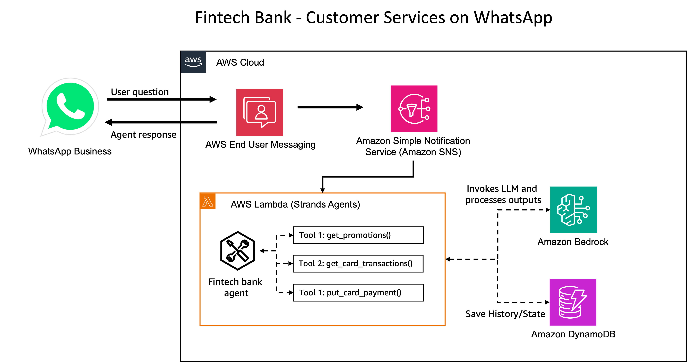
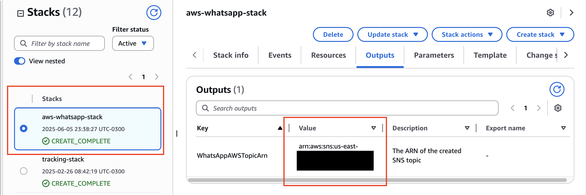
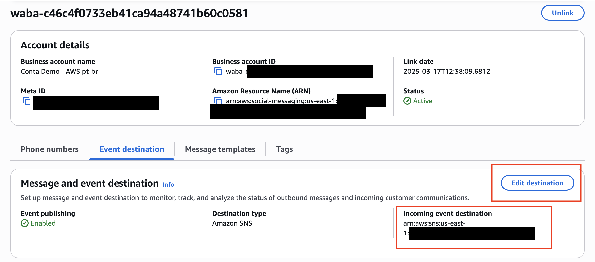
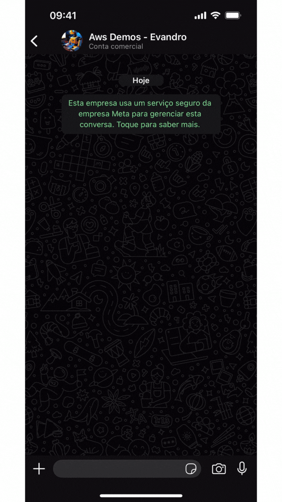

## WhatsApp for Business, Strands-Agents and Amazon Bedrock Demo

> [!IMPORTANT]
> This sample is meant to show integration of Strands agent with WhatsApp and is for inspirations purposes. Make sure to implement your organizations best practices before deploying this solution in production workloads.

This demo shows a **conformity assistant** for an operations team, built with **Strands-Agents** and Amazon Bedrock on top of Meta's WhatsApp for Business.

A field technician reports an equipment non-conformity (leak, crack, corrosion, wrong reading) on WhatsApp. The agent searches past Non-Conformity Reports in an Amazon Bedrock Knowledge Base, drafts a handling procedure, and registers it as a case awaiting validation. A conformity expert — chatting with the same agent from their own number — reviews the draft and approves or rejects it. Once approved, the technician can ask the agent to email the procedure to the equipment contractor (mocked by default; SES in Phase 3). SMS/email/RCS channels and real outbound sends are planned next.

Below is the overall architecture diagram:



|Feature             |Description                                        |
|--------------------|---------------------------------------------------|
|Chat roles          |Technician (report/status) and expert (validation), resolved per sender|
|Custom Agents       |search_ncr_history (Bedrock KB), create_case, get_case, list_cases, record_validation, request_expert_validation, send_contractor_email|
|Model Provider      |Amazon Bedrock                                     |


1. The user interacts with the WhatsApp number.
2. AWS End User Messaging receives the message and adds it to an SNS Topic.
3. A Lambda function listening to this topic resolves the sender's role and handles the message.
4. The Strands agent runs the non-conformity workflow with its tools and replies in the same chat.


## 1 - Getting started with AWS End User Messaging Social (Mandatory)

1. Have a Meta Business Account. Check if your company already has a [Meta Business Account](https://business.facebook.com/). If you don't have a Meta Business Account, you can create one during the sign-up process.

1. To use a phone number that's already in use with the WhatsApp Messenger application or WhatsApp Business application, you must delete it first.

1. A phone number that can receive either an SMS or a voice One-Time Passcode (OTP). The phone number used for sign-up becomes associated with your WhatsApp account and the phone number is used when you send messages. The phone number can still be used for SMS, MMS, and voice messaging.

1. Them, follow up "Sign up through the console" step by step guide from [AWS End User Messaging Documentation](https://docs.aws.amazon.com/social-messaging/latest/userguide/getting-started-whatsapp.html).

## 2 - AWS Envirnoment Setup

### 2.1 Amazon Bedrock Model Access

Ensure you have access to Bedrock Models. If you are using a cross-region profile, make sure the model is enabled in both regions necessary for the profile to work.

[Here](https://docs.aws.amazon.com/bedrock/latest/userguide/model-access-modify.html) is more information on how to enable model access on Amazon Bedrock.

### 2.2 - Virtual Env Setup

Create a virtual environment and install dependencies.

```
python3 -m venv .env
source .env/bin/activate
pip install -r requirements.txt
```

### 2.3 Create Lambdas, upload to S3 and deploy Cloudformation

This project supports two languages:

1. Brazilian Portuguese (pt_BR)
1. US English (en_US)

**By default, `pack_and_deploy.sh` will deploy English locale, but you can change on `template.yaml` file. Change the parameter `LocaleConfig` for the desired locale at the beginning of the CloudFormation Template file, to change solution language!**

**Before getting started, it's necessary to have a S3 Bucket available to store assets that will be created by CloudFormation stack. If you don't have a S3 Bucket, please create one following [this](https://docs.aws.amazon.com/AmazonS3/latest/userguide/create-bucket-overview.html) documentation.**

This shell script will pack all Lambda functions and deploy Cloudformation stack.

```
chmod +x pack_and_deploy.sh pack_lambda.sh

export S3_BUCKET=<S3_BUCKET>
export S3_KEY=<S3_KEY>

./pack_and_deploy.sh $S3_BUCKET $S3_KEY

```

Example:

```
./pack_and_deploy.sh my-s3-bucket my-folder-assets
```

**By default, this project is building using Python 3.11, but you can change with an optional parameter PYTHON_VERSION, by calling bash with following args:**

```
./pack_and_deploy.sh my-s3-bucket my-folder-assets "3.11"
```

### 2.4 Cloudformation post-step

After the stack is created with CloudFormation, retrieve the SNS topic from the Outputs.



This will be used as the entry point for AWS End User Messaging. **Copy** SNS output ARN value.

Go to AWS End User Messaging Console, choose *Social Messaging*, on left menu.
Choose your WhatsApp for Business account integration and click on "Event Destination" tab.
Click in "Edit Destination" to add your SNS output from Cloud Formation.



### 2.5 Demo

This is a demo showing the original sample (fintech) with English locale — the flow is the same, but the agent is now the conformity assistant:



### 2.6 Demo without a WhatsApp number (mock mode)

The CloudFormation parameter **`MockWhatsApp`** (default `true`) makes the Lambda log the agent's reply instead of sending it through AWS End User Messaging — so you can demo deployment and the agent's capabilities with **no phone number, WABA, or Event Destination setup**. **`MockEmail=true`** (default) likewise logs the contractor e-mail instead of sending it via SES.

Send a message to the deployed agent with the helper script (it publishes a realistic WhatsApp webhook event to the stack's SNS topic and tails CloudWatch Logs for the reply):

```
uv sync   # once - installs the venv deps incl. botocore[crt] for local AWS calls
.venv/Scripts/python mock_send.py "Hi, we found oil leaking around the mechanical seal of centrifugal pump P-101. What is the procedure? Contractor email: contractor@acme-demo.com"
```

The full non-conformity flow, driven entirely from the CLI:

```
# 1. Technician reports (any number except the expert's is a technician)
.venv/Scripts/python mock_send.py "Hi, we found oil leaking around the mechanical seal of centrifugal pump P-101. What is the procedure? Contractor email: contractor@acme-demo.com" --phone 5511987654321
#    -> agent searches the NCR knowledge base, drafts a procedure, creates a case (NC-...), asks the expert

# 2. Expert reviews and approves from their own chat (ExpertContacts parameter, default 5511999998888)
.venv/Scripts/python mock_send.py "Please review case NC-YYYYMMDD-xxxxxx. It looks correct." --phone 5511999998888

# 3. Technician checks status, then asks for the contractor e-mail
.venv/Scripts/python mock_send.py "What is the status of my case?" --phone 5511987654321
.venv/Scripts/python mock_send.py "Great, send the procedure by email to the contractor." --phone 5511987654321
#    -> MOCK_EMAIL logged in CloudWatch, case moves to CONTRACTOR_NOTIFIED in the NonConformityCases table
```

Useful flags: `--phone` (pick the sender — this also picks the role), `--text "..."`, `--print-event` (print the webhook JSON offline, no credentials needed), `--tail-only` (just follow the logs). Replies appear as `MOCK_WHATSAPP: reply to <phone>: ...` in the `/aws/lambda/WhatsApp-Aws-Integration-Main` log group.

When you connect a real WhatsApp number, redeploy with `MockWhatsApp=false` (see `AGENTS.md` for the update-stack command). The knowledge base `GXY5L19KJX` currently contains image-only content, so the agent's comparisons lean on the standard-practice caveat until real text NCRs are ingested.

## 3. Delete Resources

```
./destroy.sh
```
